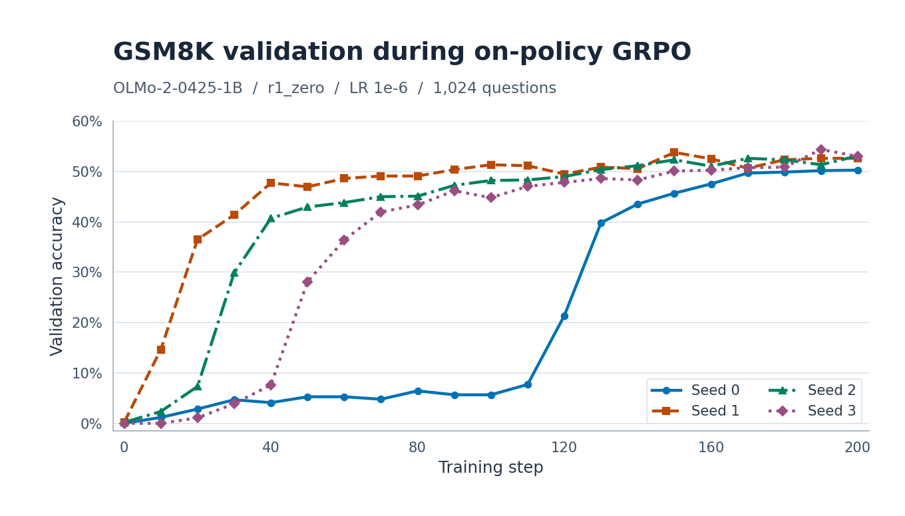

# CS336 Spring 2026 Assignment 5: Alignment

这是 Stanford CS336 Spring 2026 Assignment 5 的个人自学项目，涵盖 GSM8K 提示词评估、GRPO 核心实现和第 4 节同策略 GRPO 实验。[课程主页](https://cs336.stanford.edu/) · [作业讲义](https://github.com/stanford-cs336/assignment5-alignment/blob/main/cs336_spring2026_assignment5_alignment.pdf)

## 第 4 节实验结果

在 OLMo-2-0425-1B 上，以 `r1_zero` 提示词和 `1e-6` 学习率训练 200 步，四个种子的终点平均准确率达到 **52.27%**，种子间样本标准差为 **1.34 个百分点**。

| 随机种子 | 第 0 步准确率 | 第 200 步准确率 |
| ---: | ---: | ---: |
| 0 | 0.00% | 50.29% |
| 1 | 0.20% | 52.64% |
| 2 | 0.20% | 53.13% |
| 3 | 0.00% | 53.03% |



所有训练组使用同一批 1,024 道题和固定的 `r1_zero` 评估提示词。题目来自 GSM8K 官方测试文件的前 1,024 条，也用于比较训练配置，因此在这里作为开发验证集使用。[全部 11 组实验](docs/experiments.md) · [终点汇总 CSV](docs/results/runs.csv) · [验证曲线 CSV](docs/results/validation.csv)

本仓库提供核心实现、本地测试和实验证据。正式云端训练使用的入口和代码快照保存在本机实验存档中。离策略重要性加权的验证范围为单元测试。

## 代码导航

| 路径 | 用途 |
| --- | --- |
| [`cs336_alignment/data.py`](cs336_alignment/data.py) | 对齐提示词、回答、标签和回答掩码 |
| [`cs336_alignment/grpo.py`](cs336_alignment/grpo.py) | Token log probability、奖励和优势、GRPO 损失及梯度累积 |
| [`cs336_alignment/evaluate_prompting.py`](cs336_alignment/evaluate_prompting.py) | 评估三套提示词，写出各组指标与回答记录 |
| [`cs336_alignment/local_inference.py`](cs336_alignment/local_inference.py) | Windows 本地 Transformers 推理，使用 BF16 与 SDPA |
| [`tests/test_grpo.py`](tests/test_grpo.py) | 课程主线数值测试，覆盖同策略变体及离策略更新 |
| [`tests/test_tiny_grpo_learning.py`](tests/test_tiny_grpo_learning.py) | CPU 小模型的 20 步连续训练验证 |

## Windows 本地运行

在 PyCharm 选择项目 `.venv` 中的 Python 3.12 解释器，从项目根目录打开 Terminal。已验证的本机推理环境为 `torch==2.11.0+cu128`、`transformers==5.7.0` 和 RTX 3060 Laptop GPU（6 GB）。项目的 `uv sync` 支持平台为 Linux x86-64 和 macOS ARM64，Windows 从现有 `.venv` 直接运行。

新建 Windows 环境时，可使用以下命令安装项目的基础依赖与 CUDA 版 PyTorch。

```powershell
uv venv --python 3.12
uv pip install --python .venv/Scripts/python.exe --index-url https://download.pytorch.org/whl/cu128 'torch==2.11.0+cu128'
uv pip install --python .venv/Scripts/python.exe -e . 'transformers==5.7.0' 'accelerate==1.6.0'
```

核心测试和连续训练验证使用仓库中的小型模型或测试样本。两条命令分别运行。

```powershell
& '.\.venv\Scripts\python.exe' -m pytest tests/test_grpo.py -q
& '.\.venv\Scripts\python.exe' -m pytest tests/test_tiny_grpo_learning.py -s -q
```

本机评估需要 GSM8K `test.jsonl` 与预先下载的 OLMo 模型目录。默认数据路径为 `data/gsm8k/test.jsonl`，也可以用 `--data-path` 指定。下面的命令在项目根目录运行。按模型的实际存放位置设置 `$modelDirectory`，试跑 5 题的历史用时约 41 秒。[GSM8K 数据集](https://huggingface.co/datasets/openai/gsm8k) · [OLMo-2-0425-1B](https://huggingface.co/allenai/OLMo-2-0425-1B)

```powershell
$modelDirectory = '.\models\OLMo-2-0425-1B'
& '.\.venv\Scripts\python.exe' -m cs336_alignment.evaluate_prompting --backend transformers --model-id $modelDirectory --batch-size 1 --limit 5 --seed 0 --output-dir outputs/prompting_local_review
```

## 早期本地验证

OLMo-2-0425-1B 对 GSM8K 测试集前 50 题进行了三种提示词的推理评估，共生成 150 条回答，用时约 8 分 49 秒。采样沿用 Transformers 5.7.0 的默认 `top_k=50`。本地日志目录为 `outputs/prompting_local_50q/`。

| 提示词 | 答对 | 格式通过 |
| --- | ---: | ---: |
| `question_only` | 0/50 | 14/50 |
| `r1_zero` | 0/50 | 22/50 |
| `r1_zero_three_shot` | 12/50 | 47/50 |

GRPO 课程主线测试记录为 **19 项通过**。20 步 CPU 验证中，模型在 `Hello` 后生成 `world` 的概率从 **6.63%** 升至 **60.21%**。

## 来源与发布

本仓库是课程起始仓库的 fork。`grpo.py` 和 `data.py` 是本项目的新增实现。课程还提供独立的可选补充讲义，涉及安全对齐、指令微调和 RLHF。[课程起始仓库](https://github.com/stanford-cs336/assignment5-alignment) · [补充讲义](https://github.com/stanford-cs336/assignment5-alignment/blob/main/cs336_spring2026_assignment5_supplement_safety_rlhf.pdf) · [课程规则](https://cs336.stanford.edu/#honor-code)

上游 Spring 2026 分支未查到适用于整个仓库的通用许可证。数学评分器 `drgrpo_grader.py` 文件头标注 Apache 2.0，分发时按该许可证保留声明并附许可副本。课程测试、讲义和数据各自按来源核对授权。模型权重和数据可从对应来源获取。[评分器文件头](https://github.com/stanford-cs336/assignment5-alignment/blob/main/cs336_alignment/drgrpo_grader.py#L1-L17) · [Apache 2.0](https://www.apache.org/licenses/LICENSE-2.0)

<details>
<summary>课程起始仓库的安装说明</summary>

## Setup

As in previous assignments, we use `uv` to manage dependencies.

1. Install all packages except `flash-attn`, then all packages (`flash-attn` is weird)
```
uv sync --no-install-package flash-attn
uv sync
```

2. Run the required unit tests:

``` sh
uv run pytest tests/test_grpo.py
```

Initially, all tests should fail with `NotImplementedError`s.
To connect your implementation to the tests, complete the
functions in [./tests/adapters.py](./tests/adapters.py).

</details>

