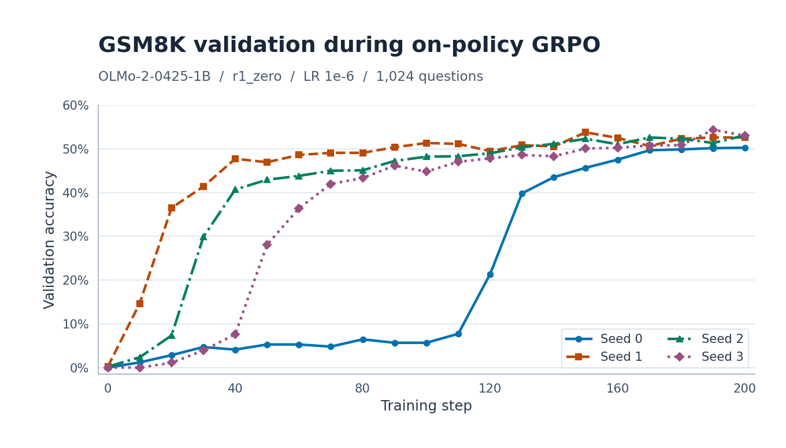

# 第 4 节同策略 GRPO 实验

在 OLMo-2-0425-1B 上，`r1_zero` 与 `1e-6` 学习率的四个随机种子从 **0–0.20%** 提升至 **50.29%–53.13%**。第 200 步平均准确率为 **52.27%**，种子间样本标准差为 **1.34 个百分点**，达到作业要求的 25% 平均终点准确率。[作业讲义](https://github.com/stanford-cs336/assignment5-alignment/blob/main/cs336_spring2026_assignment5_alignment.pdf)

## 实验协议

- **训练。** 每个种子从 GSM8K 训练集不放回抽取 6,400 道题。每步对 32 道题各生成 8 个回答，合计 256 条。梯度累积配置为 32，每批采样后执行一次优化器更新。每轮运行 200 步。
- **优化。** `standard` 配置使用组内均值基线、按组标准差缩放优势，以及按回答长度归一化的策略梯度损失。采用 AdamW，`betas=(0.9, 0.95)`，权重衰减为 0，梯度范数上限为 1。
- **验证。** 在第 0 步及之后每 10 步，使用 GSM8K 官方测试文件前 1,024 道题和固定的零样本 `r1_zero` 提示词。每题生成一次，采样温度为 1，`top_p=1.0`，`top_k=0`，最多生成 512 token。主指标是同时满足评分器格式要求和答案正确的比例。

这 1,024 道题也用于比较训练配置，因此本文将其作为开发验证集。四个主实验共用同一批题。种子间标准差描述这套验证协议下的运行差异。[GSM8K](https://huggingface.co/datasets/openai/gsm8k) · [OLMo-2-0425-1B](https://huggingface.co/allenai/OLMo-2-0425-1B)

## 11 组实验结果

每行代表一次运行，答对数的分母都是 1,024。表中的用时为存档记录的训练和验证计时，单位为分钟。粗体标出四个主实验。

| 训练提示词 | 学习率 | 种子 | 第 0 步答对 | 第 200 步答对 | 终点准确率 | 计时（分钟） |
| --- | ---: | ---: | ---: | ---: | ---: | ---: |
| `r1_zero` | `1e-6` | 0 | 0 | 515 | **50.29%** | 31.9 |
| `r1_zero` | `1e-6` | 1 | 2 | 539 | **52.64%** | 36.3 |
| `r1_zero` | `1e-6` | 2 | 2 | 544 | **53.13%** | 32.4 |
| `r1_zero` | `1e-6` | 3 | 0 | 543 | **53.03%** | 31.1 |
| `r1_zero` | `3e-6` | 0 | 0 | 73 | 7.13% | 27.4 |
| `r1_zero` | `1e-5` | 0 | 0 | 0 | 0.00% | 35.4 |
| `r1_zero` | `3e-5` | 0 | 0 | 0 | 0.00% | 35.0 |
| `question_only` | `1e-6` | 0 | 0 | 0 | 0.00% | 34.9 |
| `question_only` | `1e-6` | 1 | 1 | 0 | 0.00% | 36.0 |
| `r1_zero_three_shot` | `1e-6` | 0 | 0 | 1 | 0.10% | 40.5 |
| `r1_zero_three_shot` | `1e-6` | 1 | 2 | 5 | 0.49% | 42.3 |

### 学习率与生成退化

`1e-6` 在四个种子上都取得提升。较高学习率各只有一个种子，部分运行来自不同批次。`1e-5` 那轮在中途达到 5.76%，第 200 步回落到 0%。`3e-5` 那轮跑完了 200 步，终点 1,024 条回答全部达到 512 token 上限，格式通过率为 0%。这是该次运行的生成退化记录。现有种子数量只能支持对这些已测条件的比较。

### 提示词与判分

所有训练组最终都在 `r1_zero` 下评估。`question_only` 组的训练评分器从 `\boxed{...}` 提取答案，生成也使用不同的停止规则。它和带标签提示词的对照同时改变了训练提示、评分和停止条件。例如，存档里有回答算对了 `11 × 7 = 77`，但缺少 `<answer>`，在统一评分下得零分。三示例训练组在统一评分下分别答对 1 和 5 道题。这些成绩衡量各训练方案在固定评估协议下的表现。

## 实现与复现边界

- **组内标准差。** 实跑版本的 `torch.std()` 默认用 $G-1$ 作方差分母，讲义式（30）使用 $G$。在 $G=8$ 且忽略数值稳定项时，实跑的非零优势约为讲义值的 93.5%。上表保留实际运行的结果。
- **硬件与耗时。** 五轮补跑使用单张 RTX PRO 6000 Blackwell Server Edition。计时涵盖训练和验证，租用时长还包含启动和检查点写盘。不同显卡的整轮成本需要用相同配置实测。
- **运行记录。** 实验配置保存了随机种子、训练参数及数据的 SHA-256 哈希。基础模型只记录了模型目录，完成轮次也未导出第 200 步权重。公开仓库提供核心实现和实验证据，实际训练入口和云端代码快照保存在本机实验存档中。

## 发布数据

- [runs.csv](results/runs.csv) 含 11 组终点汇总，`initial_accuracy` 和 `final_accuracy` 均为 0 到 1 的比例，`measured_work_seconds` 为记录的训练和验证秒数。`completed` 表示跑完预定步数。
- [validation.csv](results/validation.csv) 含 231 个验证数据点，以 `run_dir` 对应终点汇总。`num_correct` 和 `num_examples` 可用于核对 `accuracy`，`format_accuracy` 为格式通过比例，`mean_response_tokens` 为平均回答长度。
- [grpo-validation.png](results/grpo-validation.png) 从验证 CSV 绘制。图中使用 `r1_zero`、`1e-6` 的四个种子，每个种子有 21 个验证点。
